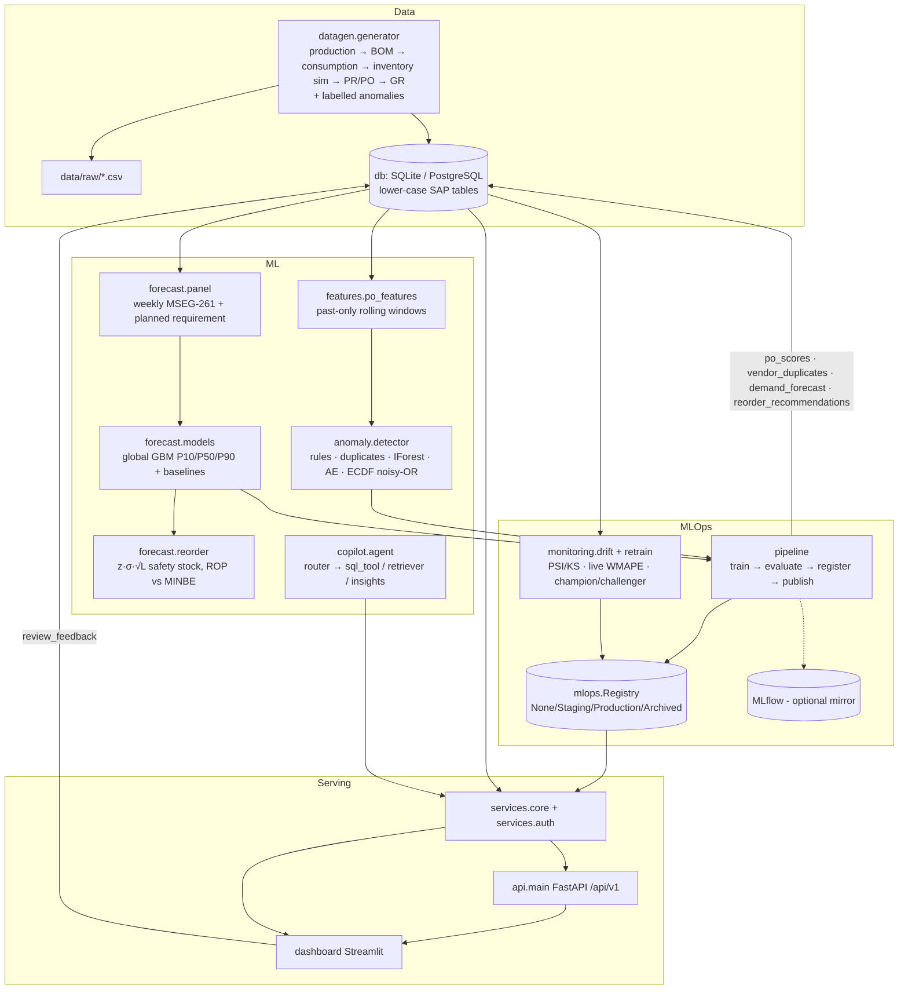
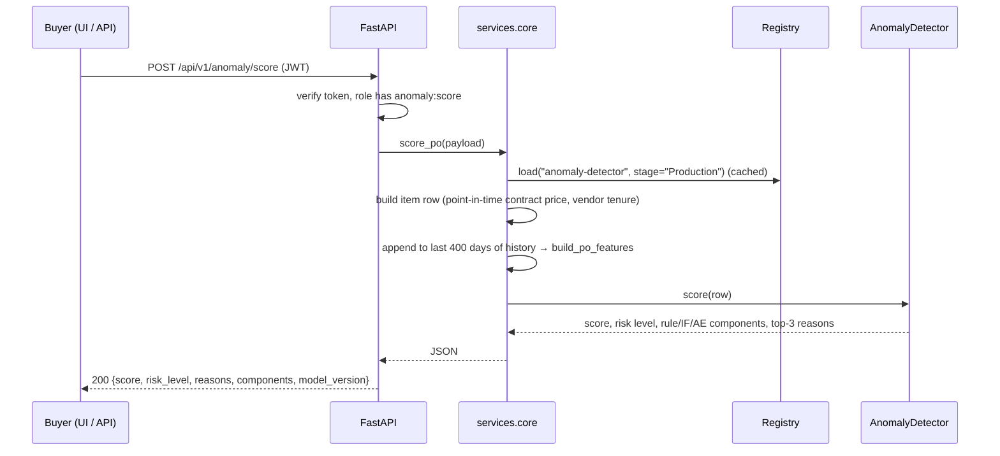
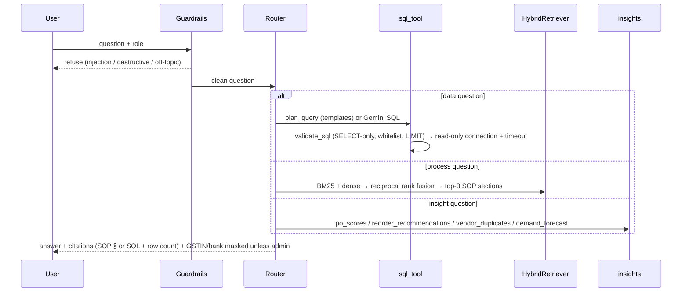
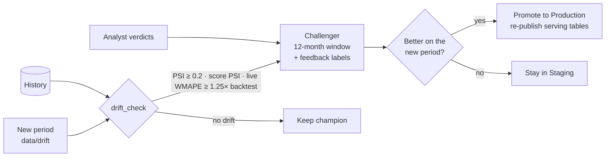

# Architecture

SupplySight is one Python package (`src/supplysight`) with four layers:

1. **Data**: a seeded SAP MM/PP generator and a database layer (SQLite by default, PostgreSQL in Docker).
2. **ML**: shared feature engineering plus three capabilities: anomaly detection, demand forecasting and the copilot.
3. **MLOps**: a training pipeline, model registry with stages, run tracking (with MLflow mirroring), drift
   monitoring and champion/challenger retraining.
4. **Serving**: a service layer used by both the FastAPI app and the Streamlit dashboard.

All data is synthetic.

## Component view

## Scoring a new purchase order

## Copilot request

## Retraining loop

## Key design choices

| Decision | Why |
|---|---|
| Lower-case SAP table/column names | The same SQL runs on SQLite and PostgreSQL; still recognisable to SAP users (EKPO-NETPR → `ekpo.netpr`). |
| Serving tables written by the pipeline | The API/dashboard answer list queries (flags, forecasts) from indexed tables in milliseconds; only single-PO scoring runs the model online. |
| File registry + MLflow mirror | Serving never depends on a tracking server; MLflow still gets runs and models for its UI. |
| Service layer shared by API and UI | One implementation of business logic; the dashboard can run in-process (demo) or through the API (Docker). |
| Optional backends detected at runtime | Runs on a laptop with only numpy/pandas/sklearn; upgrades to LightGBM, PyTorch, sentence-transformers, rapidfuzz, sqlglot and Evidently when installed. |

## Scaling to more plants / real SAP

- **Ingestion:** replace the generator with extracts via SAP OData services (e.g. `API_PURCHASEORDER_PROCESS_SRV`,
  `API_MATERIAL_DOCUMENT_SRV`), BAPIs (`BAPI_PO_GETDETAIL1`) or replication (SLT / Datasphere) into the same schema.
- **Multi-plant:** `werks` is already part of every series key and feature; the global forecaster scales with
  more series. Partition serving tables by plant and run training per company code if data volume requires.
- **Write-back:** flags stay advisory. A real integration would set a release-strategy block or a workflow item
  in SAP, never change POs automatically.
